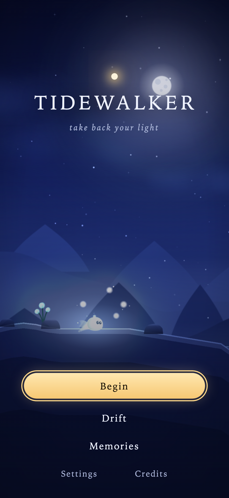

# Tidewalker

> The Tide King drowned the moon and scattered the Tideborn's powers across the deep.
> Take them back — one guardian at a time.

Tidewalker is a fast, boss-driven 2D action-platformer for phones and the browser. You play a small
luminous Tideborn with a light-blade, crossing ten drowned areas of ten levels each, beating twenty
optional guardians and ten area bosses, and earning back the movement and powers the fall took.
It is written in TypeScript on PixiJS, runs offline, and needs no account, backend, ads or analytics.
Every picture is painted by code at start-up and every sound is synthesised while you play, so the
repository contains no binary art or audio and nothing borrowed.




## The game

- **The Shallows — Tutorial.** Before the fall the Tideborn has everything: run, jump, double jump,
  wall-cling and wall-jump, dash and air dash, swim and dive, glide, strike in three directions,
  pogo off hazards with a downward strike, charge a Lumen Strike, fire a Lumen Pulse, heal with Tide
  Essence. The tutorial teaches each, then lantern checkpoints, pausing, a guardian's health bar and
  rematches, and ends with a sparring fight against the Echo of the Deep. Then the fall takes it all.
- **Ten areas × ten levels.** The Shallows, Moonlit Pools, Kelp Abyss, Drowned Ruins, Storm Reach,
  Coral Cathedral, Sunken Forge, Abyssal Gardens, The Silent Deep, and the Tide King's Throne. Each
  area has its own rule (moonglass that only light reveals, underwater combat, wind, heat, darkness
  that hunts your glow…), and every level has its own twist: locked fights, chases, timed climbs,
  flooded caves, survival holdouts, gauntlets.
- **Ten bosses**, each with two or three phases, readable telegraphs and a stagger between phases.
  Each gives a **gift** — Tidebreaker, Eclipse Veil, Vinehook, Echo Wave, Storm Step, Coral Shield,
  Ember Fang, Bloom Burst, Void Current, Tide Crown — a Lumen-powered ability you equip and swap.
- **Twenty minibosses**, two per area. Four guard a lost ability; the rest are optional and pay out
  upgrades: extra masks, more Lumen, more Essence vials, a wider Pulse.
- **Fourteen enemy kinds** with distinct answers: shellbacks block from the front, thornblooms are
  armoured until they open, burrowers surface under you, sentinels duel at range, broodmothers
  spawn mites, voidlings blink.
- **Lumen and Essence.** Lumen powers glow, Pulse, charged strikes and gifts and refills over time.
  Landing hits fills Tide Essence; hold Mend on safe ground to spend a vial and heal.
- **Fair difficulty.** Gentle (two extra masks, longer warnings, softer foes), Standard, Intense
  (shorter warnings, faster and tougher foes). No setting removes a boss or a fight.
- **Also:** 20 Memory Shells that unlock a wordless picture-story, boss rematches from the map,
  best times, and Drift — an endless, danger-free shore.
- **Accessibility:** text size, reduced motion, screen-shake toggle, visual cues for sounds,
  left- or right-handed pad, haptics toggle; danger is always shown by shape and motion as well as
  colour.

## Controls

| Action | Touch pad | Keyboard |
| --- | --- | --- |
| Move, aim up/down | Floating stick (left thumb) | ← → ↑ ↓ or WASD |
| Jump (hold for height), wall-jump, double jump; hold while falling to glide | Jump | Space / Z |
| Strike (with ↑ / ↓ in the air for up / down strikes) | Strike | X / J |
| Lumen Strike | Hold Strike, release | Hold X |
| Dash / air dash | Dash | C / K / Shift |
| Lumen Pulse (tap) · Glow (hold) | Light | V / L / E |
| Mend | Hold Mend | H / R |
| Use gift · switch gift | Gift · tap the gift badge | F · Q |
| Pause | Pause button | Esc / P |

The pad mirrors for left-handed play (Settings → Controls).

## Run it locally

Requires Node.js 20 or newer.

```bash
npm install
npm run dev          # http://localhost:5173 — open on a phone via your LAN IP, or use a mobile viewport
```

## Test it

```bash
npm run typecheck    # TypeScript strict mode
npm run lint         # ESLint
npm test             # 151 unit and integration tests, including bot playthroughs of every level
npx playwright install chromium   # once
npm run test:e2e     # 40 end-to-end tests: real touch input, phone to desktop viewports, offline
npm run check        # typecheck + lint + unit tests + production build
npm run verify:levels   # table of the bot's run through every level on every difficulty
```

`npm test` includes a verification bot that plays the tutorial and all 100 levels on Gentle,
Standard and Intense with the weakest loadout a player can have at that point, beats every boss
and collects every Memory Shell — using only the inputs a player has. See
[QA_CHECKLIST.md](QA_CHECKLIST.md).

## Production build

```bash
npm run build        # type-checks, then writes dist/ with an offline service worker
npm run preview      # serves dist/ at http://localhost:4173
```

`dist/` is a static site: host it anywhere. When hosting under a sub-path set `VITE_BASE_PATH`
(see `.env.example`). The build is about 0.85 MB (≈ 200 kB gzipped) and makes no network requests
after the first load.

## Package for Android and iOS

The project is ready to wrap with Capacitor (`capacitor.config.json` is included). Steps, icons,
splash screens, haptics and signing are in [docs/PACKAGING.md](docs/PACKAGING.md); store metadata is
in [STORE_PREP.md](STORE_PREP.md).

## Architecture

```
src/
  main.ts                 entry: creates Game, registers the service worker
  game/
    core/                 World (the simulation), Game (coordinator), loop, camera, bot, types, tuning
    entities/             player movement and combat, enemies, bosses and minibosses, props
    systems/              combat resolution, arenas, hazards, level rules, terrain, tide
    levels/               builder DSL, motifs, tutorial, areas a01–a10, progression, Drift generator
    input/                Controls (pure) and touch-pad / keyboard binding
    audio/                AudioDirector (state → mix, pure) and Web Audio engine
    effects/              PixiJS renderer, views, combat effects, lightmap, particles, haptics
    save/                 localStorage save (v2) with sanitising loader
    ui/                   HUD, touch pad and all menu screens (DOM + CSS)
  assets/                 procedural sprite atlas, backgrounds, score data, palettes, vignettes
tests/                    Vitest unit and integration tests
e2e/                      Playwright end-to-end tests
scripts/                  level verification, bot tracing, icons, store screenshots
docs/                     architecture, audio direction, packaging, screenshots
```

The simulation (`World`) is pure, deterministic, fixed-step logic with no rendering, audio or DOM.
The renderer, audio and haptics only read its state and consume its events, which is what lets the
bot and the tests play real levels headlessly. More in [docs/ARCHITECTURE.md](docs/ARCHITECTURE.md);
design intent in [DESIGN.md](DESIGN.md); area-by-area notes in [LEVELS.md](LEVELS.md).

## Licence

All code, art and audio in this repository are original to this project. No third-party assets are
included. Runtime dependency: [PixiJS](https://pixijs.com) (MIT).
