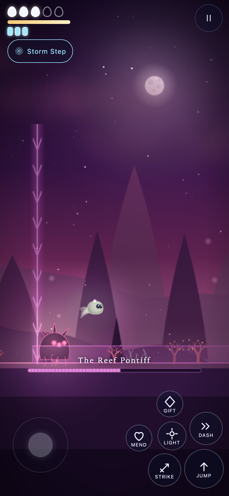

# Tidewalker

> The Tide King drowned the moon and scattered the Tideborn's powers across the deep.
> Take them back — one guardian at a time.

Tidewalker is a fast, boss-driven 2D action-platformer for phones, tablets, Mac, Windows and the
browser. You play a small Tideborn knight with a sword of light, crossing ten drowned areas of ten levels each, beating twenty
optional guardians and ten area bosses, and earning back the movement and powers the fall took.
It is written in TypeScript on PixiJS, runs offline, and needs no account, backend, ads or analytics.
Every picture is painted by code at start-up and every sound is synthesised while you play, so the
repository contains no binary art or audio and nothing borrowed.




## The game

- **The Shallows — Tutorial.** Before the fall the Tideborn has everything: run, jump, double jump,
  wall-cling and wall-jump, dash and air dash, swim and dive, glide, strike in three directions,
  pogo off hazards with a downward strike, charge a Lumen Strike, fire a Lumen Pulse, heal with Tide
  Essence. The tutorial is a training ground: after each lesson a golden gate waits until that move
  has been done **twice** (a checklist in the HUD shows what is left — sixteen moves in all, from
  jump to the three-hit combo), so every player has tried everything before the game begins. Then
  lanterns, pausing, a guardian's health bar and rematches, a sparring fight against the Echo of
  the Deep — and the fall takes it all.
- **Ten areas × ten levels.** The Shallows, Moonlit Pools, Kelp Abyss, Drowned Ruins, Storm Reach,
  Coral Cathedral, Sunken Forge, Abyssal Gardens, The Silent Deep, and the Tide King's Throne. Each
  area has its own rule (moonglass that only light reveals, underwater combat, wind, heat, darkness
  that hunts your glow…), and every level has its own twist: locked fights, chases, timed climbs,
  flooded caves, survival holdouts, gauntlets.
- **Ten bosses**, each with two or three phases, readable telegraphs and a stagger between phases.
  Each gives a **gift** — Tidebreaker, Eclipse Veil, Vinehook, Echo Wave, Storm Step, Coral Shield,
  Ember Fang, Bloom Burst, Void Current, Tide Crown — a Lumen-powered ability you equip and swap.
- **Twenty minibosses**, two per area. Four guard a lost ability; the rest are optional and pay out
  upgrades: extra masks, more Lumen, more Essence vials, a wider Pulse.
- **Fourteen sea creatures** with distinct answers, each animated part by part: crab grunts snap
  their claws, pufferfish inflate to spit, manta rays swoop, sand eels burst from the floor,
  anglerfish gape behind a lure, hermit-crab knights guard with a raised claw, octopus mothers
  call their brood, jellyfish discharge, magma lobsters slam, anemones open to fire, ghost squid
  blink and swordfish knights duel with a spear.
- **A sword combo.** Strike three times quickly: a cut, a back-cut, then a heavy finisher with a
  step forward. Mash the button and the presses queue up.
- **Swords you can see.** The Tideborn carries its sword in hand; every swing is a real arc with
  a trail of light, and struck foes squash, spark and throw up damage numbers.
- **Plasma, diamonds and the Forge.** Every foe drops plasma (banked at lanterns, lost on a fall);
  guardians, chests and trials give diamonds. Spend them at the Forge on Blade, Armour, Lumen
  Core and Essence Flask upgrades, six swords (each turning the charged strike into its own art:
  Tide Wave, Flame Arc, Chain Bolt, Thorn Spin, Rift, Radiance) and four techniques (Third Cut,
  Rising Cut, Dash Strike, Plunge).
- **Chests and relics.** A chest on every level; some hold relics — one-time Thunder, Frost,
  Draught and Nova powers.
- **Trials.** Glowing arches on levels 2, 5 and 8 of each area open onto hard elite fights with a
  grand chest behind them. Fall there and you are back at your lantern.
- **Lumen and Essence.** Lumen powers glow, Pulse, charged strikes and gifts and refills over time.
  Landing hits fills Tide Essence; hold Mend on safe ground to spend a vial and heal.
- **Fair difficulty.** Six masks to start; Gentle (two more, longer warnings, softer foes),
  Standard, Intense (shorter warnings, faster and tougher foes). No setting removes a boss or a
  fight. Area scaling is gentle; Forge upgrades are how you keep pace.
- **Also:** 20 Memory Shells that unlock a wordless picture-story, boss rematches from the map,
  best times, and Drift — an endless, danger-free shore.
- **Accessibility:** text size, reduced motion, screen-shake toggle, visual cues for sounds,
  left- or right-handed pad, haptics toggle; danger is always shown by shape and motion as well as
  colour.

## Controls

| Action | Touch pad | Keyboard |
| --- | --- | --- |
| Move, aim up/down | Floating stick (left thumb) | WASD (or arrows) |
| Jump (hold for height), wall-jump, double jump; hold while falling to glide | Jump | Space |
| Strike (with W / S for up / down strikes; three quickly for a combo) | Strike | X or left click |
| Lumen Strike (your sword's art) | Hold Strike, release | Hold X or left button |
| Dash / air dash | Dash | Shift |
| Lumen Pulse (tap) · Glow (hold) | Light | E or right click |
| Mend | Hold Mend | Hold Q |
| Use gift · switch gift | Gift · tap the gift badge | F · 1 |
| Use relic · switch relic | Tap the relic badge | R · 2 |
| Enter a trial arch | Push the stick up | W |
| Pause | Pause button | Esc / P |

**Controllers.** PlayStation (DualSense, DualShock 4), Xbox, Switch Pro and most other USB or
Bluetooth controllers work as soon as they are connected, in menus and in play, on Mac, Windows,
Android, iPhone/iPad and in the browser. Prompts and the Settings screen use the names on the
controller in hand (✕ ○ □ △ on PlayStation, A B X Y on Xbox, and so on), the controller rumbles on
hits and landings (Settings → Vibration), and pulling it out mid-fight pauses the game. With
several connected, the one pressed last takes over.

| Action | PlayStation | Xbox | Switch |
| --- | --- | --- | --- |
| Move, aim · menus | Left stick or d-pad | Left stick or d-pad | Left stick or d-pad |
| Jump | ✕ | A | B |
| Strike (hold for the sword's art) | □ | X | Y |
| Dash | ○ or L2 | B or LT | A or ZL |
| Pulse (tap) · Glow (hold) | △ | Y | X |
| Mend (hold) | R1 | RB | R |
| Use gift · switch gift | L1 · Create | LB · View | L · − |
| Use relic | R2 | RT | ZR |
| Pause | Options | Menu | + |
| Menus: choose · back | ✕ · ○ | A · B | A · B |

The pad mirrors for left-handed play (Settings → Controls). Portrait and
landscape both work.

## Run it locally

Requires Node.js 22 or newer.

```bash
npm install
npm run dev          # http://localhost:5173
npm run dev:lan      # the same, reachable from a phone on your Wi-Fi (use the Network: address)
```

## Mac, Windows, Android, iOS

```bash
npm run desktop:start    # run as a desktop app (Electron) right now
npm run desktop:mac      # desktop/release/Tidewalker-2.0.0-arm64.dmg and Tidewalker-2.0.0.dmg
npm run desktop:win      # desktop/release/Tidewalker-2.0.0-setup.exe, -portable.exe and -win.zip
npm run mobile:android   # needs Android Studio; opens the Android project
npm run mobile:ios       # needs Xcode; opens the iOS project
```

Details, signing and store notes: [docs/PACKAGING.md](docs/PACKAGING.md).

## Test it

```bash
npm run typecheck    # TypeScript strict mode
npm run lint         # ESLint
npm test             # 199 unit and integration tests, including bot playthroughs of every level
npx playwright install chromium   # once
npm run test:e2e     # 50 end-to-end tests: real touch input, portrait and landscape phones to desktop, offline
npm run check        # typecheck + lint + unit tests + production build
npm run verify:levels   # table of the bot's run through every level on every difficulty
```

`npm test` includes a verification bot that plays the tutorial and all 100 levels on Gentle,
Standard and Intense with the weakest loadout a player can have at that point, beats every boss
and collects every Memory Shell — using only the inputs a player has. See
[QA_CHECKLIST.md](QA_CHECKLIST.md).

## Production build

```bash
npm run build        # type-checks, then writes dist/ with an offline service worker
npm run preview      # serves dist/ at http://localhost:4173
```

`dist/` is a static site: host it anywhere. When hosting under a sub-path set `VITE_BASE_PATH`
(see `.env.example`). The build is about 0.85 MB (≈ 200 kB gzipped) and makes no network requests
after the first load.

## Architecture

```
src/
  main.ts                 entry: creates Game, registers the service worker
  game/
    core/                 World (the simulation), Game (coordinator), loop, camera, bot, types, tuning
    entities/             player movement and combat, enemies, bosses and minibosses, props
    systems/              combat resolution, arenas, hazards, level rules, terrain, tide
    levels/               builder DSL, motifs, tutorial, areas a01–a10, progression, Drift generator
    input/                Controls (pure), gamepad reader, touch-pad / keyboard binding
    audio/                AudioDirector (state → mix, pure) and Web Audio engine
    effects/              PixiJS renderer, views, combat effects, lightmap, particles, haptics
    save/                 localStorage save (v2) with sanitising loader
    ui/                   HUD, touch pad and all menu screens (DOM + CSS)
  assets/                 procedural sprite atlas, backgrounds, score data, palettes, vignettes
tests/                    Vitest unit and integration tests
e2e/                      Playwright end-to-end tests
scripts/                  level verification, bot tracing, mobile builds, icons, store screenshots
desktop/                  Electron shell for Mac/Windows (own package.json)
docs/                     architecture, audio direction, packaging, screenshots
```

The simulation (`World`) is pure, deterministic, fixed-step logic with no rendering, audio or DOM.
The renderer, audio and haptics only read its state and consume its events, which is what lets the
bot and the tests play real levels headlessly. More in [docs/ARCHITECTURE.md](docs/ARCHITECTURE.md);
design intent in [DESIGN.md](DESIGN.md); area-by-area notes in [LEVELS.md](LEVELS.md).

## Licence

All code, art and audio in this repository are original to this project. No third-party assets are
included. Runtime dependency: [PixiJS](https://pixijs.com) (MIT). Packaging only: Electron and
electron-builder (in `desktop/`), Capacitor (dev dependency).
